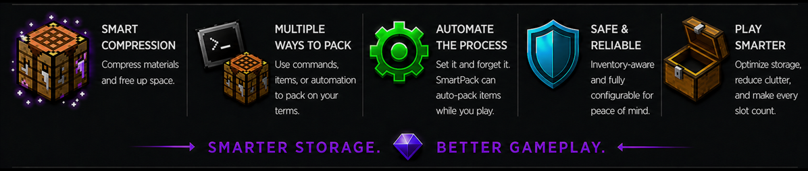

<p align="center">
  
</p>

<h1 align="center">SmartPack</h1>

<p align="center">
  <strong>Pack more. Carry less. Play smarter.</strong>
  <br>
  A Paper plugin for fast, safe Minecraft inventory compression with <code>/pack</code>.
</p>

<p align="center">
  
</p>

SmartPack packs configured inventory materials into compact storage forms, such as nuggets to ingots, ingots to blocks, redstone to redstone blocks, and other server-configured recipes. It is built for survival servers that want quick inventory cleanup with sensible safety checks.

## Highlights

- Safe inventory simulation before item changes are applied.
- Command, Smart Packer item, and optional auto-pack activation.
- Optional Smart Packer cooldown mode with live tooltip updates and a ready ActionBar notice.
- Chest inventory packing through `/pack chest` or the Smart Packer item.
- Per-player material exclusions through `/pack exclude`.
- Configurable crafting-table requirements.
- Reversible-recipe warnings and optional strict disabling.
- Inventory-full feedback with extra-slot estimates.

## Documentation

The full setup and usage guide lives in the GitHub Wiki:

- [SmartPack Wiki](https://github.com/Crosis47/SmartPack/wiki)
- [Installation](https://github.com/Crosis47/SmartPack/wiki/Installation)
- [Commands and Permissions](https://github.com/Crosis47/SmartPack/wiki/Commands-and-Permissions)
- [Configuration](https://github.com/Crosis47/SmartPack/wiki/Configuration)
- [Chest Packing](https://github.com/Crosis47/SmartPack/wiki/Chest-Packing)
- [Recipe Configuration](https://github.com/Crosis47/SmartPack/wiki/Recipe-Configuration)
- [Troubleshooting](https://github.com/Crosis47/SmartPack/wiki/Troubleshooting)

## Requirements

- Target compatibility: Paper 1.21.11 through 26.3 (one plugin JAR)
- Java 21+ for Paper 1.21.11; Java 25+ for Paper 26.x
- JDK 25+ and Maven 3.x when building from source

The build targets the Paper 26.3 API and emits Java 21 bytecode. The
`api-version` in `plugin.yml` deliberately stays at `1.21.11`: it declares the
minimum server API, not the newest supported server. SmartPack uses public
Bukkit/Paper APIs and does not depend on Minecraft internals or remapping.
Versions below 1.21.11 are not supported.

Validation for 2.1.0: compilation passed against the 1.21.11, 26.1.2, and 26.3
APIs, with Java 21 bytecode verified. The identical 26.3-built JAR passed the
server compatibility probe on Paper 1.21.11 (build 131), 26.1.2 (build 53), and
26.3 (build 227), running locally with JDK 26. CI additionally targets the
Java 21/25 runtimes listed below. Player-driven interactions still need the
in-game checks described below.

## Build

```bash
mvn clean package
```

The compiled jar is created in `target/` as `smartpack-<version>.jar`.

In Windows Codex sessions that provide a managed HTTP proxy, use:

```powershell
powershell -File .mvn/Invoke-Maven.ps1 -B -ntp clean verify
```

Maven does not automatically use the session's `HTTPS_PROXY` environment
variable. The helper reads the current proxy address and creates temporary
Maven settings, preserving any default user settings and removing the temporary
copy afterward. Outside a proxy environment it runs Maven normally. It does not
change global Codex settings or the repository-local dependency cache.

Maven uses the repository-local cache in `.mvn/repository`, configured by
`.mvn/maven.config`. Compatibility CI also compiles against Paper 1.21.11 and
26.1.2 to catch accidental use of newer APIs:

```bash
mvn clean verify -Dpaper.api.version=1.21.11-R0.1-SNAPSHOT
mvn clean verify -Dpaper.api.version=26.1.2.build.53-stable
```

The Paper Compatibility workflow also runs the same 26.3-built JAR on Paper
1.21.11 with Java 21, and Paper 26.1.2 and 26.3 with Java 25. Each disposable
server checks plugin startup, command registration/reload, SQLite exclusions and
auto-pack preferences, tiered chest inventory packing, full-inventory safety,
Smart Packer item metadata, recipe registration, and cooldown tooltip updates.
The server probe lives under `src/test/` and is packaged separately for CI; it
is never included in the production JAR. Console logs are retained as artifacts.

Before releasing, also check player-driven `/pack`, `/pack chest`, the exclusion
menu, auto-pack triggers, Smart Packer crafting, and cooldown interactions in
game. Use separate test worlds for each version. Passing compilation alone does
not establish runtime compatibility; the server matrix must pass as well.

## Release

GitHub Actions publishes releases automatically when a push to `master` changes
the Maven project version in `pom.xml`. Update `pom.xml` and `CHANGELOG.md`,
commit the version bump, and push:

```bash
git push origin master
```

The workflow builds with Java 25, verifies that the tag matches the Maven
version, creates `v<version>` after the build passes, and uploads
`target/smartpack-<version>.jar` to the GitHub release.

Releases can still be created by pushing a version tag directly:

```bash
git tag v2.1.0
git push origin v2.1.0
```

The workflow can also be run manually from the Actions tab with either `X.Y.Z`
or `vX.Y.Z`. Manual runs use an existing matching tag when one is present; when
the tag does not exist yet, the workflow creates it from the selected branch
after the build passes.

### Development Releases

Development branch pushes publish GitHub prereleases through the Dev Release
workflow. It runs on pushes to any branch except `master` or `main`.

Each build creates a historical prerelease tag named
`smartpack-dev-<branch>-<timestamp>` and uploads a jar named
`SmartPack-dev-<branch>-<timestamp>.jar`, using a UTC timestamp such as
`20260505-223000Z` at the end. A new push creates a new prerelease instead of
replacing older builds. These builds are for testing and do not replace the
stable `master` version-bump release flow.

## Install

1. Place the jar in your server's `plugins/` directory.
2. Start the server once to generate `plugins/SmartPack/config.yml`.
3. Adjust the config.
4. Run `/pack reload`.

## Commands

| Command | Description |
| --- | --- |
| `/pack` | Pack configured materials |
| `/pack chest` | Pack the chest you are looking at |
| `/pack exclude` | Choose materials to skip |
| `/pack auto` | Toggle automatic packing |
| `/pack reload` | Reload the config |

## License

SmartPack is licensed under the GNU General Public License v3.0. See [License.md](License.md).

## Credits

SmartPack is a fork of the original [MinecraftCondensePlugin](https://github.com/rd156/MinecraftCondensePlugin) by `rd156`.
