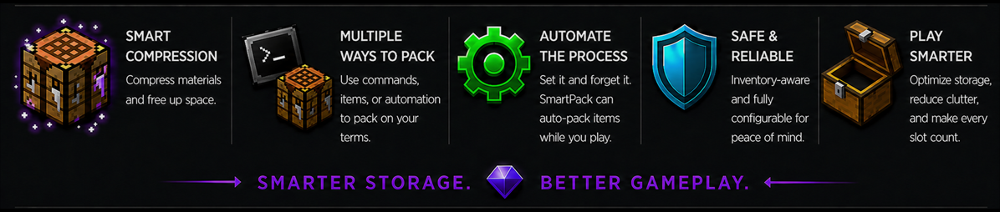

<p align="center">
  
</p>

<h1 align="center">SmartPack</h1>

<p align="center">
  <strong>Pack more. Carry less. Play smarter.</strong>
  <br>
  A Paper plugin for fast, safe Minecraft inventory compression with <code>/pack</code>.
</p>

<p align="center">
  
</p>

SmartPack packs configured inventory materials into compact storage forms, such as nuggets to ingots, ingots to blocks, redstone to redstone blocks, and other server-configured recipes. It is built for survival servers that want quick inventory cleanup with sensible safety checks.

## Highlights

- Safe inventory simulation before item changes are applied.
- Command, Smart Packer item, and optional auto-pack activation.
- Optional Smart Packer cooldown mode with live tooltip updates and a ready ActionBar notice.
- Chest inventory packing through `/pack chest` or the Smart Packer item.
- Per-player material exclusions through `/pack exclude`.
- Bedrock SmartPacker actions and exclusion controls for servers using Geyser.
- Configurable crafting-table requirements.
- Reversible-recipe warnings and optional strict disabling.
- Inventory-full feedback with extra-slot estimates.

## Requirements

- Target compatibility: Paper 1.21.11 through 26.3 (one plugin JAR)
- Java 21+ for Paper 1.21.11; Java 25+ for Paper 26.x
- JDK 25+ and Maven 3.x when building from source

The build targets the Paper 26.3 API and emits Java 21 bytecode. The
`api-version` in `plugin.yml` deliberately stays at `1.21.11`: it declares the
minimum server API, not the newest supported server. SmartPack uses public
Bukkit/Paper APIs and does not depend on Minecraft internals or remapping.
Versions below 1.21.11 are not supported.

## Install

1. Download the SmartPack JAR from [GitHub Releases](https://github.com/Crosis47/SmartPack/releases) and put it in your Paper server's `plugins/` directory.
2. Start the server once to generate `plugins/SmartPack/config.yml`.
3. Run `/pack` to pack inventory materials, or `/pack exclude` to choose materials to skip. If `/pack` asks for a crafting table, stand near one and try again.
4. After changing the config, run `/pack reload` with `smartpack.reload` permission.

### Bedrock setup

SmartPack detects Bedrock sessions through Geyser-Spigot or Floodgate on the
Paper server, including linked accounts. If Geyser runs on a proxy, install
Floodgate on the Paper backend and configure
[Floodgate data forwarding](https://geysermc.org/wiki/floodgate/api/#using-the-api-on-backend-servers).

## Commands

| Command | What it does | Permission |
| --- | --- | --- |
| `/pack` | Pack configured inventory materials | `smartpack.use` |
| `/pack chest` | Pack the chest you are looking at in command mode | `smartpack.chest` |
| `/pack exclude` | Choose materials to skip | `smartpack.use` |
| `/pack auto` | Toggle automatic packing in command mode | `smartpack.auto` |
| `/pack reload` | Reload the config | `smartpack.reload` |

All `/pack` subcommands require `smartpack.use`. Type `/pack` followed by a
space to see the subcommands available to you. On Bedrock, command suggestions
must be enabled in Geyser.

### SmartPacker on Java and Bedrock

With `activation.mode: SMART_PACKER_ITEM`, Java players right-click the
SmartPacker in their inventory to pack, or shift-right-click to toggle auto mode.
Right-clicking it while a chest is open packs that chest.

Detected Bedrock players hold the SmartPacker and use it on a block to open its
action form. Select **Pack Inventory**, **Pack Chest**, or **Enable Auto** /
**Disable Auto**. After selecting **Pack Chest**, use the held SmartPacker on a
chest within 15 seconds. SmartPack packs the chest only if it opens for you.
If the server cannot send a form, the chest-style menu provides the same actions.

The Bedrock form and the item lore show whether auto mode is enabled for your
account. The form only offers the action if you have `smartpack.auto` and the
server allows auto-pack. In cooldown mode, the item shows the cooldown in place
of auto-mode instructions.

### Exclusions on Java and Bedrock

Open `/pack exclude`. Java players left-click materials for next-run skips and
right-click for permanent exclusions. Their menu has no mode button.

On Bedrock, use **Edit Mode** in the bottom row to switch between **Next Run
Only** and **Permanent**, then click or tap the materials you want to change.
The menu opens in Next Run Only mode. Your selected mode stays active as you
change pages.

Permanent exclusions survive server restarts. **Apply Changes** or closing the
menu keeps edits; **Cancel Changes** restores the settings from when it opened.
Item-change messages appear when edits are applied, reporting only the final
changes. Editing the menu is silent, and canceled edits are not announced.

## Documentation

The full setup and usage guide lives in the GitHub Wiki:

- [SmartPack Wiki](https://github.com/Crosis47/SmartPack/wiki)
- [Installation](https://github.com/Crosis47/SmartPack/wiki/Installation)
- [Commands and Permissions](https://github.com/Crosis47/SmartPack/wiki/Commands-and-Permissions)
- [Configuration](https://github.com/Crosis47/SmartPack/wiki/Configuration)
- [Chest Packing](https://github.com/Crosis47/SmartPack/wiki/Chest-Packing)
- [Recipe Configuration](https://github.com/Crosis47/SmartPack/wiki/Recipe-Configuration)
- [Troubleshooting](https://github.com/Crosis47/SmartPack/wiki/Troubleshooting)

## Build

```bash
mvn clean package
```

The compiled jar is created in `target/` as `smartpack-<version>.jar`.

In Windows Codex sessions that provide a managed HTTP proxy, use:

```powershell
powershell -File .mvn/Invoke-Maven.ps1 -B -ntp clean verify
```

Maven does not automatically use the session's `HTTPS_PROXY` environment
variable. The helper reads the current proxy address and creates temporary
Maven settings, preserving any default user settings and removing the temporary
copy afterward. Outside a proxy environment it runs Maven normally. It does not
change global Codex settings or the repository-local dependency cache.

Maven uses the repository-local cache in `.mvn/repository`, configured by
`.mvn/maven.config`. Compatibility CI also compiles against Paper 1.21.11 and
26.1.2 to catch accidental use of newer APIs:

```bash
mvn clean verify -Dpaper.api.version=1.21.11-R0.1-SNAPSHOT
mvn clean verify -Dpaper.api.version=26.1.2.build.53-stable
```

The Paper Compatibility workflow also runs the same 26.3-built JAR on Paper
1.21.11 with Java 21, and Paper 26.1.2 and 26.3 with Java 25. Each disposable
server checks plugin startup, command registration/reload, SQLite exclusions and
auto-pack preferences, tiered chest inventory packing, full-inventory safety,
Smart Packer item metadata, recipe registration, and cooldown tooltip updates.
The probe also checks command visibility, exclusion editing, pagination, Apply
and Cancel, and the SmartPacker's auto-mode controls. Test actual Bedrock menus
and autocomplete in a Bedrock client connected through Geyser.
The server probe lives under `src/test/` and is packaged separately for CI; it
is never included in the production JAR. Console logs are retained as artifacts.

Before releasing, also check player-driven `/pack`, `/pack chest`, the exclusion
menu, auto-pack triggers, Smart Packer crafting, and cooldown interactions in
game. Use separate test worlds for each version. Passing compilation alone does
not establish runtime compatibility; the server matrix must pass as well.

## Release

GitHub Actions publishes a release when a version bump in `pom.xml` reaches
`master`. Include the `pom.xml` change and matching `CHANGELOG.md` entry in the
release PR.

The workflow builds with Java 25, verifies that the tag matches the Maven
version, creates `v<version>` after the build passes, and uploads
`target/smartpack-<version>.jar` to the GitHub release.

Releases can still be created by pushing a version tag directly:

```bash
git tag v2.2.0
git push origin v2.2.0
```

The workflow can also be run manually from the Actions tab with either `X.Y.Z`
or `vX.Y.Z`. Manual runs use an existing matching tag when one is present; when
the tag does not exist yet, the workflow creates it from the selected branch
after the build passes.

### Development Releases

Development branch pushes publish GitHub prereleases through the Dev Release
workflow. It runs on pushes to any branch except `master` or `main`.

Each build creates a historical prerelease tag named
`smartpack-dev-<branch>-<timestamp>` and uploads a jar named
`SmartPack-dev-<branch>-<timestamp>.jar`, using a UTC timestamp such as
`20260505-223000Z` at the end. A new push creates a new prerelease instead of
replacing older builds. These builds are for testing and do not replace the
stable `master` version-bump release flow.

## License

SmartPack is licensed under the GNU General Public License v3.0. See [License.md](License.md).

## Credits

SmartPack is a fork of the original [MinecraftCondensePlugin](https://github.com/rd156/MinecraftCondensePlugin) by `rd156`.
